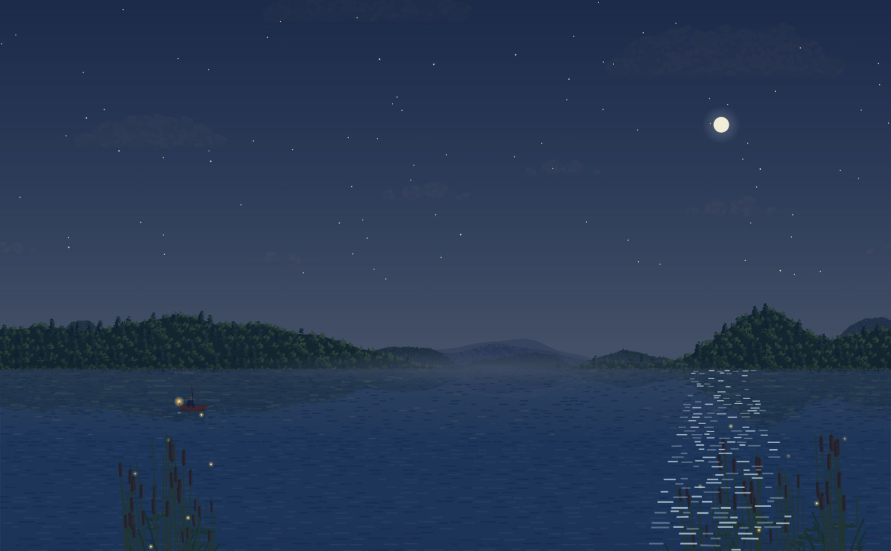

# Stipple Seasons · 点彩四季

[简体中文](README.md) · **English** · [Español](README.es.md) · [Português](README.pt.md) · [Français](README.fr.md) · [Deutsch](README.de.md) · [Русский](README.ru.md) · [日本語](README.ja.md) · [한국어](README.ko.md)

A theme mod for the Claude Code desktop app: a stipple (pointillist) lake that keeps moving behind the chat. The seasons turn, clear skies, cloud and snow come and go, and the sun and moon rise and set by your local clock.


| | |
|---|---|
| <br>Spring, morning | <br>Summer, noon |
| <br>Winter, snowing | <br>Dawn |
| <br>Dusk | <br>Summer night: moonlight and fireflies |

The whole picture is one SVG generated by code (about 120,000 characters), with no image assets. The screenshots here only show it at different moments.

## What is in the picture

- **Woods and their reflection**: wooded slopes painted in small dabs on both shores, layers of pale blue hills behind them, all mirrored in the lake.
- **Wind**: gusts cross from right to left. Treetops lean a little, leaves turn their pale side, the reeds sway and the clouds drift the same way.
- **A boat**: a small boat paddles to a fishing spot and stops. The fisherman sits and waits, and now and then lands a fish. At night a lantern hangs at the bow.
- **Seasons**: one year takes 60 minutes by default. Fresh green in spring, deep green and water lilies in summer, gold and red in autumn, snow on the woods and thin ice on the water in winter.
- **Weather**: clear, cloudy and snow come with the seasons, or can be held.
- **Day and night**: the sun and moon follow the local clock (worked out for 31°N), and the light changes through dawn, noon, dusk and night. The moon has a different phase each day.
- **Animals**: by day gulls and a flock of birds cross the sky, a fish sometimes jumps and leaves a ring, and on summer nights there are fireflies by the shore.

## Install

You need the Claude Code desktop app. In any session, run:

```
/plugin install stipple-seasons --marketplace Crazybrain555/stipple-seasons
```

The backdrop appears by itself once installed. Use `/lake` to see its state and change it.

## Commands

| Command | What it does |
|---|---|
| `/lake` | Show the current state, today’s sunrise and sunset, and the moon’s phase |
| `/lake auto` | Let seasons and weather both turn by themselves |
| `/lake spring` `summer` `autumn` `winter` | Hold one season (`春` `夏` `秋` `冬` also work) |
| `/lake clear` `cloudy` `snow` | Hold the weather (`晴` `阴` `雪` also work); `/lake weather` lets it follow the seasons again |
| `/lake year <minutes>` | How long a year lasts, 4 to 1440 minutes, 60 by default |
| `/lake full` `lite` `test` | The full picture, a lighter one, a diagnostic one |
| `/lake off` `on` | Turn it off or on |

## If the picture stands still

While it plays a backdrop, the desktop app times every frame and stops the motion for good when the average goes over about 5.56 ms, leaving a still picture: it moves for a second or two and then freezes. This is more likely when the computer is busy or in a power-saving mode. Try `/lake lite` first. `/lake test` shows only sky, lake and boat, to check that the app can play motion at all.

## Code

| | |
|---|---|
| `hooks/scene.ts` | The scene generator: dabs, trees, clouds, ripples, boat and birds, and four shared “engines” for wind, light, water and animals |
| `hooks/day.ts` | Where the sun and moon stand |
| `hooks/register.tsx` | Theme colours, the `/lake` command, and the backdrop hook |
| `hooks/make-colors.js` | The colour helper from Anthropic’s theme-examples plugin, which mods are meant to copy; unchanged |
| `tests/lake.test.tsx` | Tests run with `claude plugin test .`, including the desktop app’s limits on a backdrop SVG |

Painting and code by Claude. The direction, and what stayed in each version, was decided by the author after looking at it in the app.
