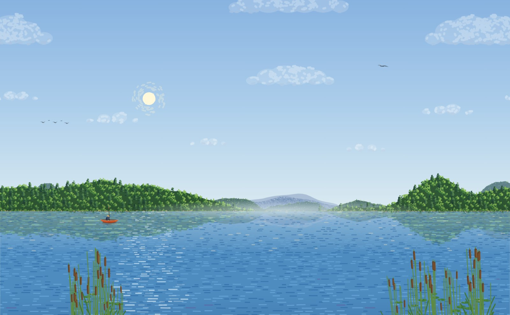

# Stipple Seasons · 点彩四季

[简体中文](README.md) · [English](README.en.md) · [Español](README.es.md) · **日本語** · [Français](README.fr.md)

Claude Code デスクトップアプリ用のテーマ mod です。チャットの背後で、点描の湖の風景が動き続けます。四季がめぐり、晴れ・曇り・雪が移り変わり、太陽と月は現地時刻に合わせて昇り沈みします。


| | |
|---|---|
| <br>春・午前 | <br>夏・正午 |
| <br>冬・雪 | <br>夜明け |
| <br>夕暮れ | <br>夏の夜・月明かりと蛍 |

絵全体はコードで生成した 1 つの SVG（約 12 万文字）で、画像素材は使っていません。ここのスクリーンショットは、さまざまな時刻の様子を写したものです。

## 描かれているもの

- **森と映り込み**：両岸には点描で描いた木々の斜面、その奥に淡い青の山並みが重なり、すべて湖面に映ります。
- **風**：風が右から左へ吹き抜けます。梢がわずかに傾き、葉が白い裏を見せ、葦が揺れ、雲も同じ向きに流れます。
- **小舟**：小舟が釣り場まで漕いで止まり、釣り人は座って待ち、ときどき魚を釣り上げます。夜は舳先に灯りがともります。
- **四季**：既定では 60 分で 1 年です。春は若葉、夏は深い緑と睡蓮、秋は金と赤、冬は森に雪が積もり水面に薄氷が張ります。
- **天気**：晴れ・曇り・雪が季節とともに移り変わり、固定もできます。
- **昼と夜**：太陽と月は現地時刻に従い（北緯 31 度で計算）、夜明け・昼・夕暮れ・夜で光の色が変わります。月の満ち欠けは日ごとに変わります。
- **生き物**：昼はカモメや鳥の群れが空を横切り、ときどき魚が跳ねて波紋が広がり、夏の夜は岸辺に蛍が飛びます。

## インストール

Claude Code デスクトップアプリが必要です。任意のセッションで次を実行します。

```
/plugin install stipple-seasons --marketplace Crazybrain555/stipple-seasons
```

インストールすると背景が自動で表示されます。`/lake` で状態の確認と変更ができます。

## コマンド

| コマンド | 内容 |
|---|---|
| `/lake` | 現在の状態、今日の日の出・日の入り、月相を表示 |
| `/lake auto` | 季節も天気も自動で移り変わる |
| `/lake spring` `summer` `autumn` `winter` | 季節を固定 |
| `/lake clear` `cloudy` `snow` | 天気を固定。`/lake weather` で季節まかせに戻す |
| `/lake year <分>` | 1 年の長さ。4〜1440 分、既定は 60 |
| `/lake full` `lite` `test` | 完全版、軽量版、診断用の絵 |
| `/lake off` `on` | オフ、オン |

## 絵が止まったままのとき

デスクトップアプリは背景の再生中に毎フレームの時間を計り、平均が約 5.56 ミリ秒を超えると動きを止めて静止画にします。1〜2 秒動いてから止まるのが特徴です。パソコンの負荷が高いときや省電力モードのときに起きやすくなります。まず `/lake lite` を試してください。`/lake test` は空・湖・舟だけの診断用の絵で、アプリが動きを再生できるかを確かめられます。

## コード

| | |
|---|---|
| `hooks/scene.ts` | シーン生成器。点描、木、雲、さざ波、舟、鳥と、風・光・水・生き物の 4 つの共通「エンジン」 |
| `hooks/day.ts` | 太陽と月の位置 |
| `hooks/register.tsx` | テーマの配色、`/lake` コマンド、背景の接続 |
| `hooks/make-colors.js` | Anthropic 公式 theme-examples プラグインにある、mod にコピーして使う配色ツール（無変更） |
| `tests/lake.test.tsx` | `claude plugin test .` で実行するテスト。背景 SVG に対するアプリの制限も含みます |

絵とコードは Claude が作りました。方向性と各版で何を残すかは、作者がアプリで見て決めました。
