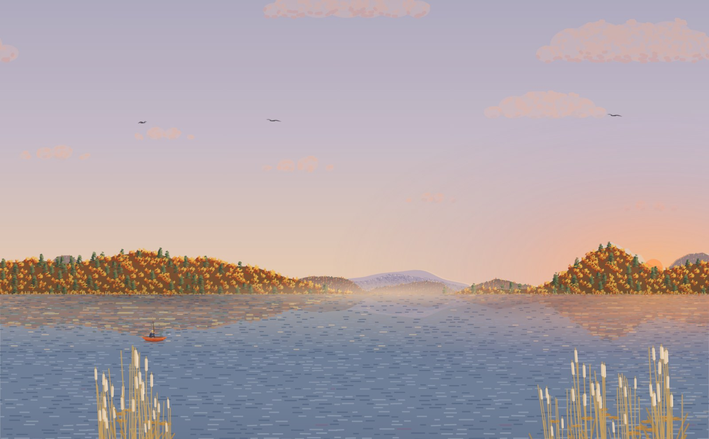

# Stipple Seasons · 点彩四季

[English](README.md) · [简体中文](README.zh.md) · [Español](README.es.md) · [Português](README.pt.md) · [Français](README.fr.md) · [Deutsch](README.de.md) · [Русский](README.ru.md) · [日本語](README.ja.md) · **한국어**

Claude Code 데스크톱 앱용 테마 mod입니다. 대화 창 뒤에서 점묘화로 그린 호수 풍경이 계속 움직입니다. 사계절이 돌고, 맑음·흐림·눈이 오가며, 해와 달은 현지 시각에 맞춰 뜨고 집니다.


| | |
|---|---|
| <br>봄 · 오전 | <br>여름 · 정오 |
| <br>겨울 · 눈 | <br>새벽 |
| <br>해 질 녘 | <br>여름밤 · 달빛과 반딧불이 |

그림 전체는 코드로 만든 SVG 하나(약 12만 자)이며 이미지 파일은 쓰지 않습니다. 아래 스크린샷은 여러 시각의 모습을 담은 것입니다.

## 그림에 담긴 것

- **숲과 그림자**: 양쪽 기슭에는 작은 붓 터치로 그린 숲 비탈이 있고, 그 뒤로 옅은 푸른 산이 겹겹이 서 있으며, 모두 호수에 비칩니다.
- **바람**: 바람이 오른쪽에서 왼쪽으로 불어 갑니다. 나무 끝이 살짝 기울고 잎이 밝은 뒷면을 보이며, 갈대가 흔들리고 구름도 같은 쪽으로 흘러갑니다.
- **작은 배**: 작은 배가 낚시터까지 노를 저어 가서 멈춥니다. 낚시꾼은 앉아서 기다리다 가끔 물고기를 낚아 올립니다. 밤에는 뱃머리에 등불을 답니다.
- **사계절**: 기본값으로 60분이 한 해입니다. 봄은 연둣빛, 여름은 짙은 초록과 수련, 가을은 금빛과 붉은빛, 겨울은 숲에 눈이 쌓이고 물 위에 살얼음이 낍니다.
- **날씨**: 맑음, 흐림, 눈이 계절에 따라 오가며, 고정할 수도 있습니다.
- **낮과 밤**: 해와 달은 현지 시각을 따르고(북위 31도 기준), 새벽·한낮·해 질 녘·밤에 따라 빛이 달라집니다. 달의 모양은 날마다 다릅니다.
- **동물**: 낮에는 갈매기와 새 떼가 하늘을 가로지르고, 가끔 물고기가 뛰어올라 물결을 남기며, 여름밤 물가에는 반딧불이가 납니다.

## 설치

Claude Code 데스크톱 앱이 필요합니다. 아무 세션에서나 다음을 실행하세요.

```
/plugin install stipple-seasons --marketplace Crazybrain555/stipple-seasons
```

설치하면 배경이 저절로 나타납니다. `/lake`로 상태를 확인하고 바꿀 수 있습니다.

## 명령

| 명령 | 설명 |
|---|---|
| `/lake` | 현재 상태, 오늘의 해돋이·해넘이, 달의 모양을 보여 줍니다 |
| `/lake auto` | 계절과 날씨가 모두 저절로 바뀝니다 |
| `/lake spring` `summer` `autumn` `winter` | 한 계절에 고정합니다 |
| `/lake clear` `cloudy` `snow` | 날씨를 고정합니다. `/lake weather`는 다시 계절을 따르게 합니다 |
| `/lake year <분>` | 한 해의 길이. 4~1440분, 기본값 60 |
| `/lake full` `lite` `test` | 전체 그림, 가벼운 그림, 진단용 그림 |
| `/lake off` `on` | 끄기, 켜기 |

## 그림이 멈춰 있을 때

데스크톱 앱은 배경을 재생하는 동안 매 프레임의 시간을 재고, 평균이 약 5.56밀리초를 넘으면 움직임을 완전히 멈추고 정지 화면만 남깁니다. 1~2초 움직이다가 멈추는 것이 특징입니다. 컴퓨터가 바쁘거나 절전 모드일 때 더 잘 일어납니다. 먼저 `/lake lite`를 써 보세요. `/lake test`는 하늘, 호수, 배만 있는 진단용 그림으로, 앱이 움직임을 재생할 수 있는지 확인하는 데 씁니다.

## 코드

| | |
|---|---|
| `hooks/scene.ts` | 장면 생성기: 붓 터치, 나무, 구름, 물결, 배, 새, 그리고 바람·빛·물·동물을 맡는 네 개의 공용 “엔진” |
| `hooks/day.ts` | 해와 달의 위치 |
| `hooks/register.tsx` | 테마 색, `/lake` 명령, 배경 연결 |
| `hooks/make-colors.js` | Anthropic 공식 theme-examples 플러그인에서 mod에 복사해 쓰도록 제공하는 색상 도구(수정 없음) |
| `tests/lake.test.tsx` | `claude plugin test .`로 실행하는 테스트. 배경 SVG에 대한 앱의 제한도 포함합니다 |

그림과 코드는 Claude가 만들었습니다. 방향과 각 버전에 무엇을 남길지는 작성자가 앱에서 직접 보고 정했습니다.
