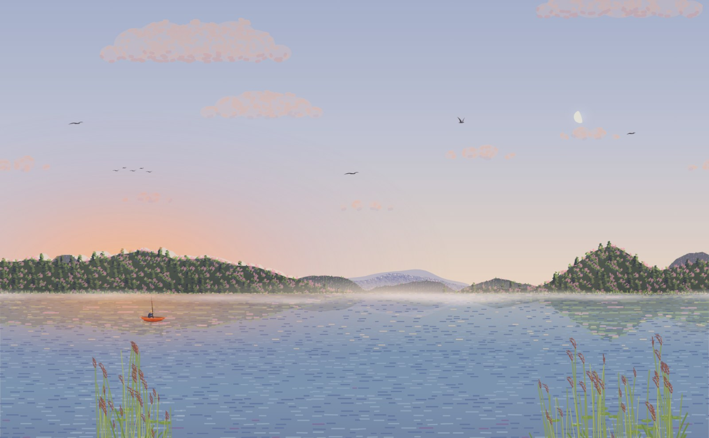

# 点彩四季 · Stipple Seasons

**简体中文** · [English](README.en.md) · [Español](README.es.md) · [Português](README.pt.md) · [Français](README.fr.md) · [Deutsch](README.de.md) · [Русский](README.ru.md) · [日本語](README.ja.md) · [한국어](README.ko.md)

Claude Code 桌面应用的主题 mod：聊天窗口背后是一幅一直在动的点彩湖景。四季轮转，阴晴雪来去，日月按你的本地时间升落。


| | |
|---|---|
| <br>春 · 上午 | <br>夏 · 正午 |
| <br>冬 · 下雪 | <br>黎明 |
| <br>黄昏 | <br>夏夜 · 月光与萤火虫 |

整幅画是代码生成的一个 SVG（约 12 万字符），没有任何图片素材；这里的截图只是它在不同时刻的样子。

## 画面里有什么

- **山林与倒影**：两岸是点彩笔触画的林木山坡，远处有几层淡蓝的山，全都倒映在湖里。
- **风**：风从右向左一阵阵吹过，树梢微微倾斜，叶片翻出浅色的一面，芦苇跟着摇，云也顺着风飘。
- **小舟**：一叶小舟划到钓点停下，渔夫坐着垂钓，偶尔钓上一条鱼；夜里船头点一盏灯。
- **四季**：默认 60 分钟走完一年。春天嫩绿，夏天浓绿、睡莲开花，秋天金红，冬天林子落雪、水面结薄冰。
- **天气**：晴、阴、雪随季节来去，也可以定住。
- **昼夜**：太阳和月亮按本地时钟升起落下（按北纬 31° 计算），黎明、正午、黄昏、夜晚的光色随之变化；月相每天不同。
- **生灵**：白天有海鸥和成群的飞鸟横穿天空，鱼偶尔跃出水面留下一圈涟漪，夏夜岸边有萤火虫。

## 安装

需要 Claude Code 桌面应用。在任意会话里运行：

```
/plugin install stipple-seasons --marketplace Crazybrain555/stipple-seasons
```

装好后背景会自动出现；用 `/lake` 查看状态和调整。

## 命令

| 命令 | 作用 |
|---|---|
| `/lake` | 显示当前状态、今天的日出日落和月相 |
| `/lake auto` | 四季和天气都自动轮转 |
| `/lake spring` `summer` `autumn` `winter` | 定格在一个季节（也可写 `春` `夏` `秋` `冬`） |
| `/lake clear` `cloudy` `snow` | 定住天气（也可写 `晴` `阴` `雪`）；`/lake weather` 恢复随季节（也可写 `天气`） |
| `/lake year <分钟>` | 一年有多长，4–1440 分钟，默认 60 |
| `/lake full` `lite` `test` | 完整版、精简版、诊断画面 |
| `/lake off` `on` | 关闭、打开 |

## 画面不动时

桌面应用播放背景时会给每一帧计时，平均超过约 5.56 毫秒就停掉动画，只留一张静态图，表现为“动一两秒就定住”。电脑负载高或开着省电模式时更容易出现。先试 `/lake lite`；`/lake test` 是只有天空、湖和小船的诊断画面，用来确认应用本身能播放动画。

## 代码结构

| | |
|---|---|
| `hooks/scene.ts` | 场景生成器：色点、树、云、水纹、小舟、飞鸟，以及风、光影、水波、动物四个共用的“引擎” |
| `hooks/day.ts` | 太阳和月亮的位置 |
| `hooks/register.tsx` | 主题配色、`/lake` 命令、背景的挂接 |
| `hooks/make-colors.js` | Anthropic 官方 theme-examples 插件里供 mod 复制使用的配色工具，原样未改 |
| `tests/lake.test.tsx` | 用 `claude plugin test .` 运行的测试，包括桌面应用对背景 SVG 的限制 |

作画和代码由 Claude 完成；方向和每一版的取舍，由作者在应用里看过之后决定。
