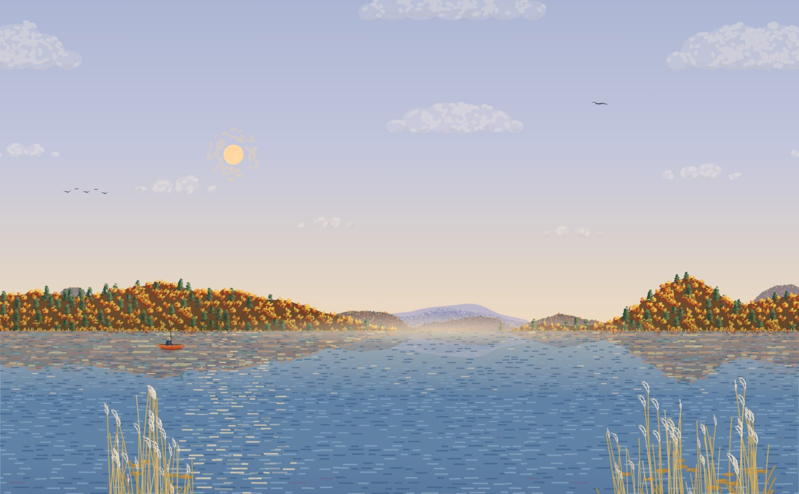
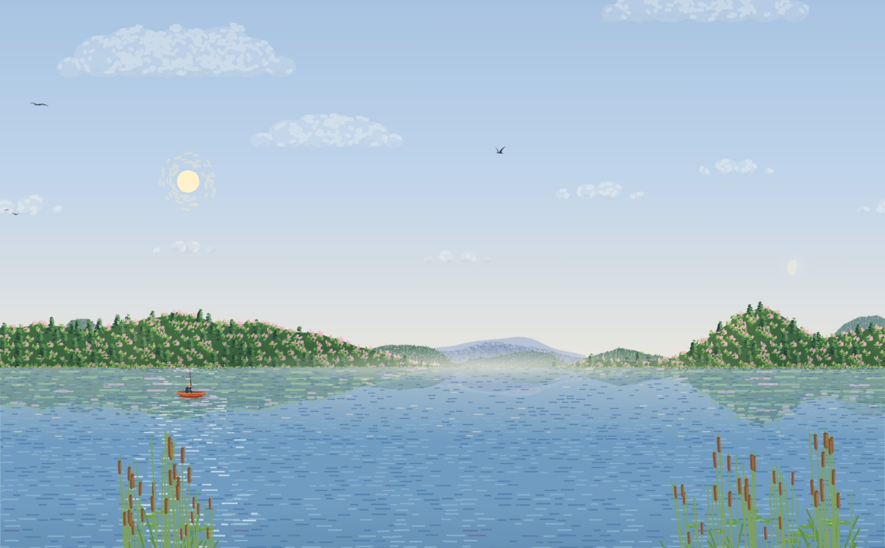
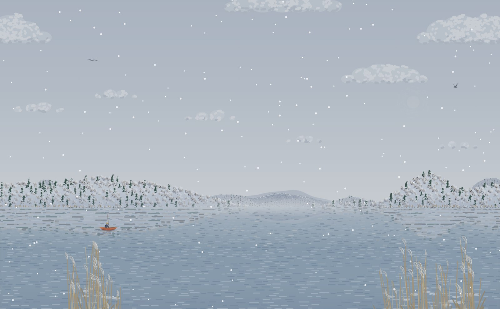

# Stipple Seasons · 点彩四季

[English](README.md) · [简体中文](README.zh.md) · [Español](README.es.md) · **Português** · [Français](README.fr.md) · [Deutsch](README.de.md) · [Русский](README.ru.md) · [日本語](README.ja.md) · [한국어](README.ko.md)

Um tema (mod) para o aplicativo de desktop do Claude Code: um lago pontilhista que não para de se mover atrás da conversa. As estações passam, o céu fica limpo, nublado ou neva, e o sol e a lua nascem e se põem de acordo com a sua hora local.



| | |
|---|---|
| <br>Primavera, de manhã | <br>Verão, ao meio-dia |
| <br>Inverno, nevando | <br>Amanhecer |
| <br>Entardecer | <br>Noite de verão: luar e vaga-lumes |

A imagem inteira é um único SVG gerado por código (cerca de 120 000 caracteres), sem nenhum arquivo de imagem. As capturas apenas o mostram em momentos diferentes.

## O que há na imagem

- **Bosques e seu reflexo**: encostas arborizadas pintadas com pequenas pinceladas nas duas margens, camadas de colinas azul-claras ao fundo, e tudo refletido no lago.
- **Vento**: as rajadas cruzam da direita para a esquerda. As copas se inclinam um pouco, as folhas mostram o lado claro, os juncos balançam e as nuvens seguem na mesma direção.
- **Um barco**: um barquinho rema até um ponto de pesca e para. O pescador espera sentado e, de vez em quando, puxa um peixe. À noite há uma lanterna na proa.
- **Estações**: um ano dura 60 minutos por padrão. Verde tenro na primavera, verde intenso e nenúfares no verão, dourado e vermelho no outono, neve nos bosques e gelo fino na água no inverno.
- **Tempo**: céu limpo, nublado e neve vêm com as estações, ou podem ser fixados.
- **Dia e noite**: o sol e a lua seguem o relógio local (calculado para 31° N) e a luz muda entre o amanhecer, o meio-dia, o entardecer e a noite. A lua tem uma fase diferente a cada dia.
- **Animais**: de dia, gaivotas e um bando de aves cruzam o céu, às vezes um peixe salta e deixa um anel na água, e nas noites de verão há vaga-lumes na margem.

## Instalação

Você precisa do aplicativo de desktop do Claude Code. Em qualquer sessão, execute:

```
/plugin install stipple-seasons --marketplace Crazybrain555/stipple-seasons
```

O fundo aparece sozinho depois de instalado. Use `/lake` para ver o estado e alterá-lo.

## Comandos

| Comando | O que faz |
|---|---|
| `/lake` | Mostra o estado atual, o nascer e o pôr do sol de hoje e a fase da lua |
| `/lake auto` | As estações e o tempo mudam sozinhos |
| `/lake spring` `summer` `autumn` `winter` | Fixa uma estação |
| `/lake clear` `cloudy` `snow` | Fixa o tempo; `/lake weather` volta a seguir as estações |
| `/lake year <minutos>` | Quanto dura um ano, de 4 a 1440 minutos, 60 por padrão |
| `/lake full` `lite` `test` | A imagem completa, uma mais leve, uma de diagnóstico |
| `/lake off` `on` | Desligar ou ligar |

## Se a imagem ficar parada

Enquanto reproduz um fundo, o aplicativo mede cada quadro e interrompe o movimento de vez quando a média passa de cerca de 5,56 ms, deixando uma imagem fixa: ela se move por um ou dois segundos e congela. Isso é mais provável com o computador ocupado ou em modo de economia de energia. Tente primeiro `/lake lite`. `/lake test` mostra só céu, lago e barco, para verificar se o aplicativo consegue reproduzir movimento.

## Código

| | |
|---|---|
| `hooks/scene.ts` | O gerador da cena: pinceladas, árvores, nuvens, ondulações, barco e aves, e quatro “motores” compartilhados para vento, luz, água e animais |
| `hooks/day.ts` | A posição do sol e da lua |
| `hooks/register.tsx` | As cores do tema, o comando `/lake` e a ligação do fundo |
| `hooks/make-colors.js` | O utilitário de cores do plugin theme-examples da Anthropic, feito para ser copiado nos mods; sem alterações |
| `tests/lake.test.tsx` | Testes executados com `claude plugin test .`, incluindo os limites do aplicativo para um SVG de fundo |

Pintura e código por Claude. A direção, e o que ficou em cada versão, foi decidida pelo autor depois de ver o resultado no aplicativo.
